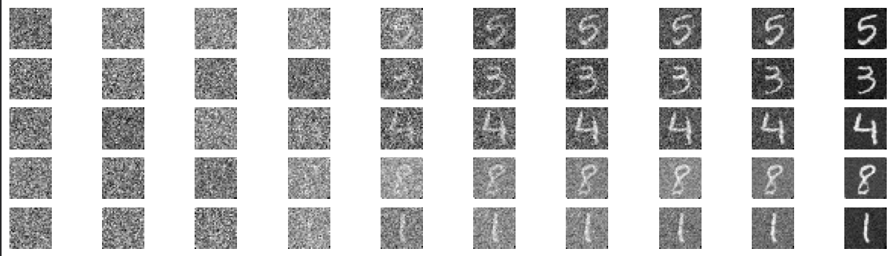

# Generative AI System: Score-Based Diffusion on MNIST

Machine learning project on score-based diffusion models for generating handwritten digits (MNIST), built with PyTorch.



*Reverse diffusion process: each row starts from pure noise (left) and ends in a generated digit (right).*

## What it does

- **Forward diffusion processes:** Variance Exploding (exponential schedule) and Variance Preserving (linear and cosine schedules).
- **Samplers:** Euler-Maruyama, Predictor-Corrector and Probability Flow ODE.
- **Evaluation:** Bits per Dimension (BPD), Fréchet Inception Distance (FID) and Inception Score (IS).
- **Controllable generation:** class-conditional sampling (generate a chosen digit) and image imputation (complete masked images).

The full method and results are in the [report](report.pdf).

## Repository structure

```text
.
├── project.ipynb              # main experiments and results
├── report.pdf
├── requirements.txt
├── diffusion_model.py
├── diffusion_process.py
├── diffusion_utilities.py
├── noise_schedule.py
├── score_model.py
├── score_model_generation.py
├── probability_flow_ode_likelihood.py
├── integrators/               # Euler-Maruyama, Predictor-Corrector, Probability Flow ODE
├── generation/                # class-conditional sampling, imputation
├── quality/                   # BPD, FID
└── trained_models/            # trained models (.pth) and training notebooks
```

## How to run

```bash
pip install -r requirements.txt
jupyter notebook project.ipynb
```

MNIST is downloaded automatically by `torchvision`. The trained models are in `trained_models/`, together with the notebooks used to train them.

## Credits

Developed for the course *Aprendizaje Automático III* at Universidad Autónoma de Madrid. The base files `score_model.py`, `diffusion_process.py` and `diffusion_utilities.py` were provided by the course instructor.

Main reference: Song, Y., Sohl-Dickstein, J., Kingma, D. P., Kumar, A., Ermon, S., & Poole, B. (2021). *Score-Based Generative Modeling through Stochastic Differential Equations*. ICLR. https://arxiv.org/abs/2011.13456
